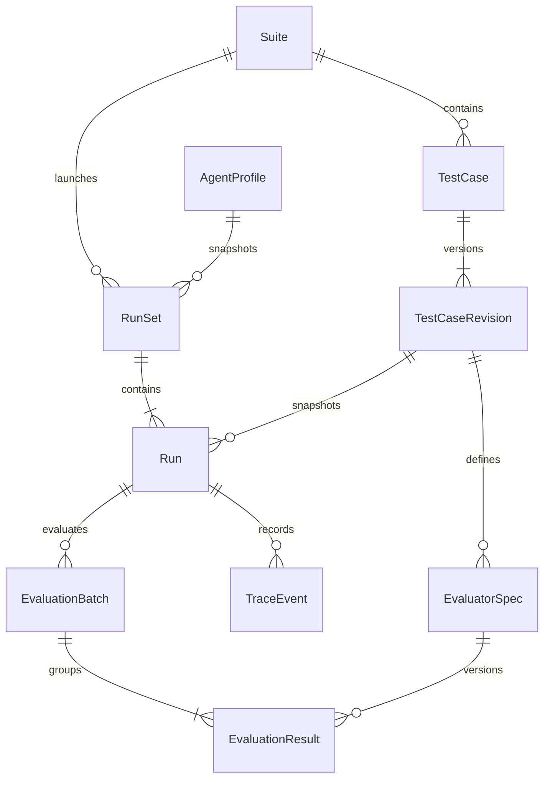
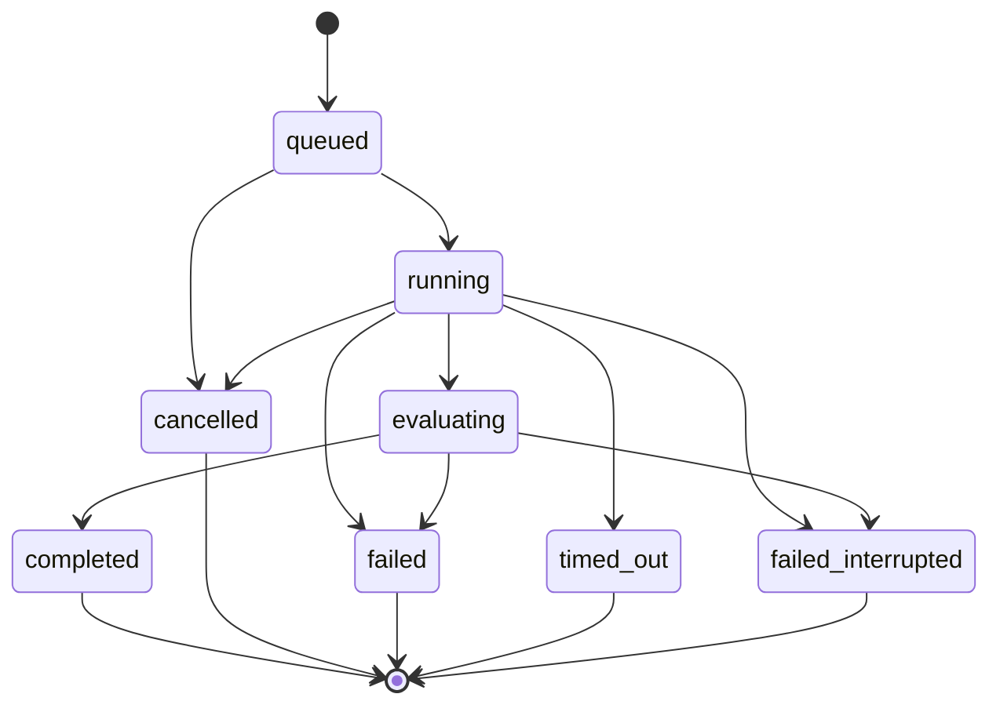
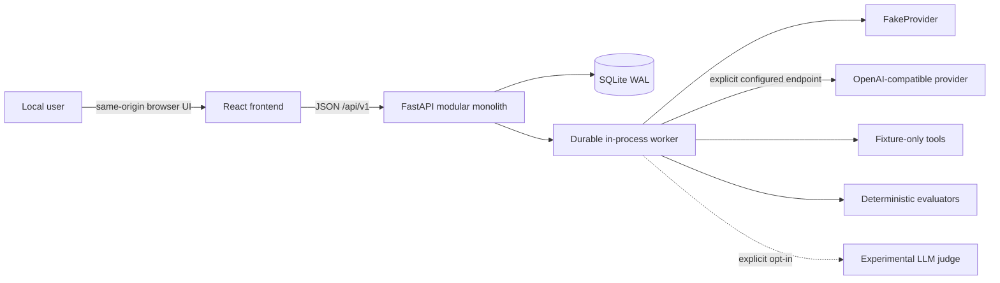
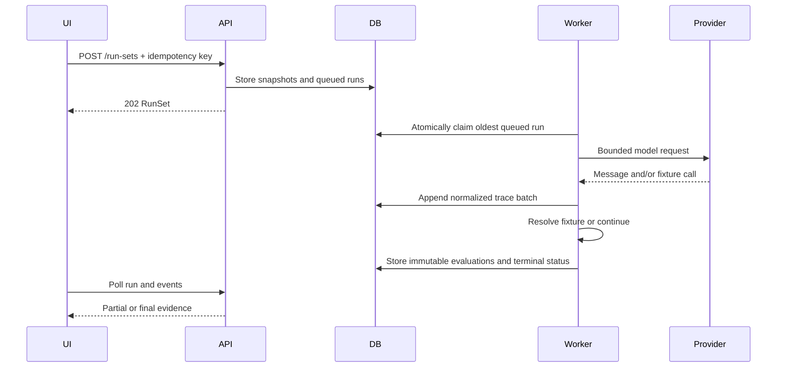
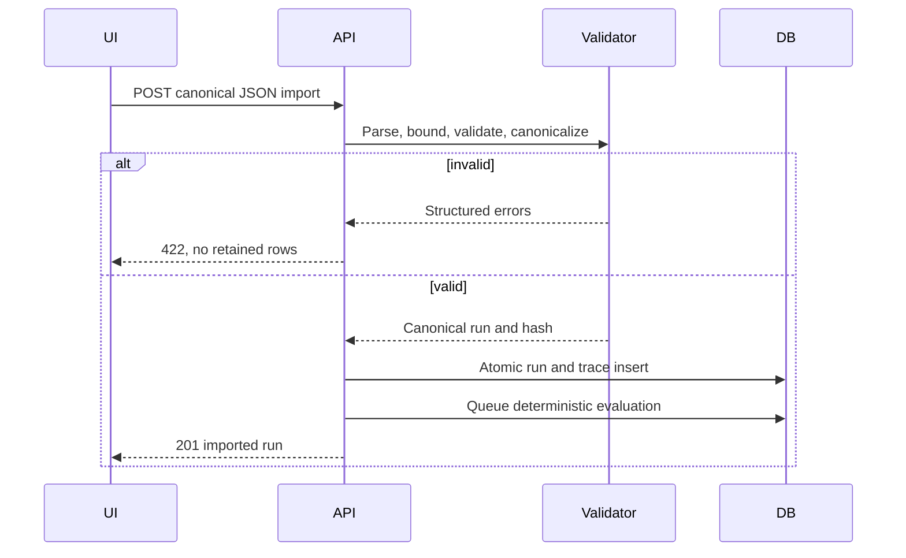

# AI Agent Evaluation Lab Product Requirements Document

## 1. Document Control

| Field | Value |
|---|---|
| Status | Draft for implementation review |
| Product owner | Jeremy |
| Intended readers | Codex implementer, frontend designer using OpenDesign, QA reviewer |
| Product phase | Greenfield MVP |
| Last updated | 2026-09-23 |
| Delivery target | Local-first portfolio application |

### Terminology

| Term | Definition |
|---|---|
| Suite | A named collection of test cases evaluated together. |
| TestCase | A stable logical test identified by a `case_key`. |
| TestCaseRevision | An immutable version of a test case's inputs, fixtures, metadata, and evaluators. |
| AgentProfile | A non-secret configuration for a provider, model, instructions, generation settings, and backend-configured credential alias. |
| RunSet | One launch operation covering selected test cases with one profile snapshot. |
| Run | One executed or imported test-case attempt with immutable inputs and status. |
| TraceEvent | One append-only, ordered event containing execution evidence. |
| EvaluatorSpec | A versioned deterministic or experimental judge configuration attached to a case revision. |
| EvaluationResult | An immutable evaluator verdict, score if applicable, evidence, and provenance. |
| Deterministic evaluator | A bounded evaluator that returns the same result for identical canonical input and configuration. |
| LLM judge | An optional probabilistic evaluator using a language model, reported separately from deterministic results. |
| Evaluation error | The evaluator could not produce a valid verdict. It is not an agent failure. |
| Incomplete run | A run lacking a complete authoritative evaluation because execution or required evaluation did not finish normally. |

**DOC-001:** The product MUST distinguish `agent failure`, `evaluator failure`, `not evaluated`, `cancelled`, `timed out`, and `malformed trace`. These states MUST NOT collapse into one generic failure or a numeric zero.

## 2. Executive Summary

AI Agent Evaluation Lab is a local-first, single-user application for defining versioned agent tests, executing a bounded fixture-only tool-calling agent or importing canonical traces, inspecting evidence, and producing reproducible evaluations.

The MVP uses a React and TypeScript frontend, a Python FastAPI backend, SQLite in WAL mode through SQLAlchemy and Alembic, and one durable in-process worker. `FakeProvider` supports a complete deterministic demo without paid APIs. One direct OpenAI-compatible HTTP adapter supports opt-in real-provider runs.

Deterministic evaluators are authoritative. An LLM judge is optional, experimental, probabilistic, separately labeled, and never silently merged into deterministic scores. Historical case revisions, run snapshots, traces, and evaluation results remain immutable so verdicts can be explained and reproduced.

### Required implementation stack

The supported MVP stack is Python 3.12+, FastAPI, Pydantic 2 in strict mode, SQLAlchemy 2, Alembic, SQLite WAL, `httpx`, and `jsonschema` for the backend. The frontend uses React, TypeScript strict mode, Vite, React Router, and TanStack Query. Verification uses pytest, Vitest, React Testing Library, Playwright, Ruff, and mypy. Python dependency and environment management uses `uv`. Substituting foundational libraries requires a documented architecture decision showing equal behavior, safety, and lifecycle cost.

Use synchronous SQLAlchemy sessions and short transactions. Generate TypeScript types from committed OpenAPI using `openapi-typescript`, then use a thin typed `fetch` client. Add a timeout-capable regex engine for the required bounded regex evaluator; standard-library `re` alone does not meet the timeout requirement. Use npm with a committed lockfile, plain CSS or CSS Modules, and semantic native controls before considering extra UI libraries. Avoid Redux, Monaco, and a second backend runtime. Both a documented native `uv`/npm local workflow and a single-image Docker workflow are supported; Docker is not required for everyday local use.

## 3. Problem Statement

Agent builders need more than a final answer and a single score. Existing workflows often hide tool calls, confuse agent failures with evaluator failures, mutate test definitions without preserving history, and present missing metrics as zeros. This makes debugging and comparison unreliable.

The product provides a small, inspectable system in which:

- execution evidence is preserved before scoring;
- deterministic assertions are separated from probabilistic judgment;
- every verdict links to concrete trace evidence;
- interruptions and partial results remain visible;
- historical runs retain the exact inputs used at launch;
- safe fixture tools replace arbitrary code execution.

## 4. Product Goals and Non-Goals

### Goals

- **G-001:** Deterministic evaluation MUST be repeatable and explainable from stored evidence.
- **G-002:** Historical runs MUST remain reproducible through immutable case and profile snapshots.
- **G-003:** A first deterministic demo MUST work without external credentials through `FakeProvider`.
- **G-004:** Users MUST be able to distinguish agent failure, evaluator failure, skipped evaluation, and missing evidence.
- **G-005:** Users MUST be able to re-evaluate a stored run without rerunning the agent.
- **G-006:** Comparisons MUST expose incompatible revisions, evaluator configurations, and profile settings.
- **G-007:** The project SHOULD demonstrate production-minded agent engineering suitable for a portfolio.

### Non-goals

The MVP is not:

- a generic agent framework;
- a prompt-management platform;
- a hosted SaaS product;
- an arbitrary agent sandbox;
- a model leaderboard;
- a dataset labeling or fine-tuning platform;
- a real side-effecting automation system;
- a multi-user collaboration product.

## 5. Target User and Jobs to Be Done

### Primary persona

A Python-first developer or student building and debugging tool-calling agents locally. The user understands JSON and basic evaluation concepts but should not need distributed-systems expertise.

### Jobs to be done

1. Define versioned agent test cases and expected behavior.
2. Execute a bounded fixture-only agent or import a canonical trace.
3. Inspect ordered messages, tool calls, results, timings, usage, and errors.
4. Run deterministic evaluators and optional LLM judging.
5. Compare compatible runs without hiding missing or failed metrics.
6. Trace every failed verdict to exact evidence.
7. Cancel work and recover safely after interruption.
8. Export or copy canonical redacted data for debugging and portfolio review.

## 6. Product Principles

1. **Evidence before scores.** Every verdict must be inspectable.
2. **Deterministic checks before LLM judgment.** Probabilistic judgment cannot replace objective assertions.
3. **Missing data is never zero.** Missing, unavailable, skipped, and errored are explicit states.
4. **Immutable history over convenient mutation.** New revisions and results preserve prior facts.
5. **Safe fixtures over arbitrary execution.** The runner can invoke only predefined, side-effect-free fixture tools.
6. **Local-first before hosted complexity.** The MVP optimizes for one user and one machine.
7. **Honest compatibility.** Comparisons disclose material differences instead of fabricating rankings.
8. **Bounded work.** Execution, imports, payloads, retries, and concurrency have enforced limits.

## 7. MVP Scope

The MVP provides these stable scope requirements:

1. **MVP-001:** Suite creation, editing, listing, and deletion with explicit impact disclosure.
2. **MVP-002:** Stable test cases with immutable revisions.
3. **MVP-003:** Fixture-tool definitions and deterministic evaluator specifications.
4. **MVP-004:** Agent profiles containing only non-secret settings and backend-configured aliases of credential environment variables.
5. **MVP-005:** Provider connectivity checks that do not reveal credentials.
6. **MVP-006:** Run-set launch against selected cases.
7. **MVP-007:** Execution through `FakeProvider` or one OpenAI-compatible endpoint contract.
8. **MVP-008:** Transactional canonical JSON trace import.
9. **MVP-009:** Ordered trace inspection with evaluator evidence.
10. **MVP-010:** Re-evaluation without agent rerun.
11. **MVP-011:** Comparison of 2–5 runs.
12. **MVP-012:** Cooperative cancellation of queued or running work.
13. **MVP-013:** Safe restart recovery without silently replaying ambiguous provider calls.
14. **MVP-014:** Explicitly confirmed deletion of private run data.
15. **MVP-015:** Redacted canonical JSON export and copy actions.

## 8. User Journeys

### 8.1 First-run deterministic demo

Create a suite, create a case, define a fixture tool, add deterministic evaluators, select `FakeProvider`, launch a run, observe queued and running states, then inspect the completed trace and evidence-backed verdicts.

### 8.2 Real-provider run

Create an agent profile, select a backend-configured credential alias, run a connection check, launch selected cases, inspect partial trace data during polling, and review final usage, errors, and evaluations.

### 8.3 Canonical trace import

Choose a JSON file, validate it without partial writes, display all validation failures, import it atomically, evaluate it, and inspect import provenance. Viewing or importing a trace never triggers tools or model requests.

### 8.4 Regression comparison

Select a baseline and 1–4 candidate runs. Align rows by stable `case_key`. Show statuses, deterministic verdict deltas, latency, token usage, available cost, and explicit incompatibility warnings.

### 8.5 Failure diagnosis

Open a failed evaluator result, inspect expected and actual values, follow evidence links to exact trace events, and distinguish agent behavior from evaluator configuration or execution errors.

### 8.6 Recovery after interruption

Restart the application after interrupted execution. Previously active work becomes `failed_interrupted`; partial traces remain visible. The product never silently repeats an ambiguous provider call.

## 9. Functional Requirements

### 9.1 Suites

- **FR-SUITE-001:** The system MUST create a suite with a unique opaque ID, non-empty name of 1–120 characters, optional description up to 2,000 characters, timestamps, and optimistic version.
- **FR-SUITE-002:** The system MUST list suites with cursor pagination and show case count, latest activity, and version.
- **FR-SUITE-003:** Suite updates MUST require the expected optimistic version; stale updates MUST return `409 Conflict`.
- **FR-SUITE-004:** Suite deletion MUST show affected case and run counts and require explicit confirmation. Deletion removes the selected aggregate and its private descendants as one transaction; it does not rewrite surviving historical records.

### 9.2 Test cases and revisions

- **FR-CASE-001:** Each case MUST have a stable `case_key`, unique within its suite, matching `^[A-Za-z0-9][A-Za-z0-9._-]{0,99}$`.
- **FR-CASE-002:** Creating or editing executable case content MUST create a new immutable `TestCaseRevision` rather than mutate an existing revision.
- **FR-CASE-003:** A revision MUST contain input messages, fixture tools, evaluator specs, metadata, revision number, and creation time.
- **FR-CASE-004:** The API MUST reject unknown fields, invalid role sequences, duplicate fixture-tool names, and invalid evaluator configurations before persistence.
- **FR-CASE-005:** Duplicating a case MUST create a new case ID and user-confirmed unique `case_key`, copying content into revision 1.
- **FR-CASE-006:** Deleting a case MUST disclose retained historical-run impact and require confirmation.

### 9.3 Agent profiles

- **FR-PROFILE-001:** A profile MUST record provider type, provider base URL where applicable, model, system instructions, generation settings, optional backend-configured credential alias, and optimistic version. The alias resolves to a backend environment-variable name, never to a credential value in the profile.
- **FR-PROFILE-002:** The profile MUST NOT contain credential values in the browser, API payloads, database, snapshots, exports, or logs.
- **FR-PROFILE-003:** Only `fake` and `openai_compatible` provider types are supported.
- **FR-PROFILE-004:** A connectivity check MUST be an explicit user action, use bounded timeouts, return a safe result, and never persist or echo secrets.
- **FR-PROFILE-005:** Provider URLs MUST use `http` or `https`, be treated only as configured model endpoints, and MUST NOT be accessible to fixture tools or trace content.
- **FR-PROFILE-006:** Profile updates MUST require the expected optimistic version and return `409` on stale writes.

### 9.4 Run sets and runs

- **FR-RUN-001:** Creating a run set MUST accept 1–200 selected cases, one profile, and an idempotency key.
- **FR-RUN-002:** Repeating run creation with the same idempotency key and canonical request MUST return the original result and MUST NOT create duplicate runs.
- **FR-RUN-003:** Reusing an idempotency key with a different canonical request MUST return `409 Conflict`.
- **FR-RUN-004:** Every run MUST snapshot the selected case revision, evaluator specs, profile configuration excluding secrets, runner limits, and canonical input hash.
- **FR-RUN-005:** Runs MUST be durably queued in SQLite and claimed by the in-process worker outside request lifetime.
- **FR-RUN-006:** Partial trace events MUST remain readable while a run is active or after it fails.
- **FR-RUN-007:** Cancellation MUST be cooperative, idempotent, and checked before provider calls and after tool results.
- **FR-RUN-008:** A terminal run MUST never transition to a nonterminal state or later become successful after cancellation.
- **FR-RUN-009:** On startup, persisted nonterminal initial runs in `running` or `evaluating` MUST transition to `failed_interrupted` without replay. An interrupted re-evaluation changes only its evaluation-batch status and never rewrites a terminal run status.
- **FR-RUN-010:** Provider or infrastructure failure MUST remain distinct from evaluator failure.

### 9.5 Legal run transitions

```text
queued -> running -> evaluating -> completed
queued -> cancelled
running -> cancelled | failed | timed_out | failed_interrupted
running -> evaluating
evaluating -> failed | completed | failed_interrupted
```

`cancelled`, `failed`, `timed_out`, `failed_interrupted`, and `completed` are terminal. A completed run can still contain deterministic evaluator failures; completion means processing finished, not that every assertion passed.

### 9.6 Trace events

- **FR-TRACE-001:** Trace events MUST be append-only after insertion.
- **FR-TRACE-002:** Each event MUST have a unique, strictly increasing sequence number within its run.
- **FR-TRACE-003:** Supported event types MUST include input message, model request, model response, assistant message, tool call, tool result, execution error, usage, and lifecycle event.
- **FR-TRACE-004:** A tool result MUST reference an earlier tool call in the same run.
- **FR-TRACE-005:** Parent event links MUST refer to an earlier event in the same run and MUST NOT form cycles.
- **FR-TRACE-006:** Event payloads MUST be size-bounded, validated by type, safely rendered, and redacted before persistence where secrets are detected.

### 9.7 Imports

- **FR-IMPORT-001:** Canonical imports MUST declare a supported schema version.
- **FR-IMPORT-002:** The server MUST enforce a 10 MiB file limit and 10,000-event limit before committing data.
- **FR-IMPORT-003:** Import validation MUST reject malformed JSON, unknown required schema versions, duplicate sequences, invalid causal links, oversized payloads, and illegal terminal-state combinations.
- **FR-IMPORT-004:** Invalid imports MUST be rejected atomically with no suite, run, trace, or result rows retained.
- **FR-IMPORT-005:** Imported runs MUST store provenance, import time, schema version, input hash, and optional user-provided source label.
- **FR-IMPORT-006:** Import idempotency MUST use an explicit idempotency key; identical retries return the original imported run.
- **FR-IMPORT-007:** Importing or viewing data MUST NEVER execute model calls, fixture tools, URLs, files, HTML, scripts, or actions embedded in content.

#### Canonical trace document version 1.0

`schema_version: "1.0"` is the only required import version for MVP. Imports and exports use UTF-8 JSON with this logical shape:

```json
{
  "schema_version": "1.0",
  "source_label": "optional string",
  "case_snapshot": {
    "case_key": "weather.basic",
    "name": "Basic weather lookup",
    "revision_number": 1,
    "input_messages": [],
    "fixture_tools": [],
    "evaluator_specs": []
  },
  "profile_snapshot": {
    "provider_type": "fake",
    "base_url": null,
    "model": "fake-v1",
    "system_instructions": "",
    "generation_config": {},
    "credential_alias": null
  },
  "runner_limits": {},
  "run": {
    "status": "completed",
    "started_at": "2026-09-17T00:00:00Z",
    "ended_at": "2026-09-17T00:00:01Z",
    "duration_ms": 1000,
    "usage": null,
    "error": null
  },
  "events": []
}
```

- **FR-IMPORT-008:** Required top-level fields are `schema_version`, `case_snapshot`, `profile_snapshot`, `runner_limits`, `run`, and `events`; `source_label` is optional. Unknown fields are rejected in version 1.0.
- **FR-IMPORT-009:** `input_messages` use `{role, content}` where `role` is `system | user | assistant | tool` and `content` is an ordered array of `{type: "text", text}` or `{type: "json", value}` parts. Tool-role messages also carry `tool_call_id`.
- **FR-IMPORT-010:** Every event uses `{event_id, sequence, type, occurred_at, duration_ms, parent_event_id, provider_request_id, payload}`. IDs are document-local opaque strings; nullable fields are explicit `null`.
- **FR-IMPORT-011:** Event payloads are strict by type: messages use the message shape; `tool_call` uses `{tool_call_id, tool_name, arguments}`; `tool_result` uses `{tool_call_id, outcome, content}`; `execution_error` uses `{code, message, retryable}`; `usage` uses non-negative token counts plus nullable decimal `cost_usd` and currency; `lifecycle` uses `{from_status, to_status, reason}`. Model request/response payloads use normalized messages, tool declarations/calls, model settings, and finish reason rather than unbounded provider-native objects.
- **FR-IMPORT-012:** Fixture tools use `{name, description, input_schema, fixtures}`. Each fixture maps canonical JSON arguments to one bounded JSON result or declared fixture error. Evaluator specs use the section 10 type, required flag, weight, ordinal, and strict config.
- **FR-IMPORT-013:** Canonical JSON hashing sorts object keys lexicographically, preserves array order, encodes UTF-8 without insignificant whitespace, rejects duplicate keys and non-finite numbers, normalizes timestamps to UTC RFC 3339, and keeps decimal money as strings. The canonical input hash covers `case_snapshot`, `profile_snapshot`, and `runner_limits`; a document digest covers all required top-level content except `source_label`.
- **FR-IMPORT-014:** Export uses the same versioned shape after redaction. Server database IDs, export time, UI state, and idempotency transport headers are not canonical hash inputs.

### 9.8 Evaluation

- **FR-EVAL-001:** Deterministic evaluators MUST consume immutable run evidence and immutable evaluator configuration.
- **FR-EVAL-002:** Evaluation results MUST be immutable and include evaluator type/version, configuration hash, input hash, status, optional score, summary, and evidence.
- **FR-EVAL-003:** Re-evaluation MUST create new results without mutating or deleting prior results.
- **FR-EVAL-004:** A required evaluator `fail` MUST mark the deterministic evaluation as failed.
- **FR-EVAL-005:** A required evaluator `error` MUST mark the deterministic evaluation as incomplete, not failed with score zero.
- **FR-EVAL-006:** Evidence MUST contain stable pointers to trace event IDs or explicit run fields plus bounded expected and actual excerpts.

### 9.9 Experimental LLM judge

- **FR-JUDGE-001:** LLM judging MUST be disabled until explicitly configured and requested.
- **FR-JUDGE-002:** The UI and API MUST label judge results `Experimental` and `Probabilistic`.
- **FR-JUDGE-003:** The judge MUST have no tools, file access, URL actions, browser access, or authority to change run state.
- **FR-JUDGE-004:** The judge MUST return strict structured output containing `verdict`, `score`, `reason`, and `cited_event_ids`.
- **FR-JUDGE-005:** Judge results MUST preserve model, provider, rubric version, sampling settings, input hash, parse status, usage, and bounded redacted raw response.
- **FR-JUDGE-006:** The judge MAY retry structured-output parsing once and MUST report failure after that retry.
- **FR-JUDGE-007:** Sending a stored trace to an external judge MUST require explicit confirmation naming the receiving provider.

### 9.10 Comparison

- **FR-COMPARE-001:** A comparison MUST contain 2–5 runs and align rows by stable `case_key`.
- **FR-COMPARE-002:** The system MUST display case revision, evaluator configuration, profile, model, generation-setting, runner-limit, and source differences.
- **FR-COMPARE-003:** Incompatible metrics MUST be marked unavailable or non-rankable, never coerced to zero.
- **FR-COMPARE-004:** Ties MUST remain ties; the system MUST NOT invent a winner.
- **FR-COMPARE-005:** Comparison MUST be computed as a query/view and MUST NOT become a persisted MVP domain entity.

### 9.11 Data export and deletion

- **FR-DATA-001:** Users MUST be able to copy or export a canonical redacted run and trace JSON document.
- **FR-DATA-002:** Exports MUST exclude credential values and apply the same redaction rules as UI and logs.
- **FR-DATA-003:** Destructive deletion MUST identify scope, require explicit confirmation, execute transactionally, and report failure without partial success.
- **FR-DATA-004:** Immutable means records cannot be edited in place. Explicit deletion of a complete private aggregate remains allowed and auditable in local application logs without retaining its sensitive content.

## 10. Evaluation Semantics

### 10.1 Common result contract

**EVAL-001:** Every evaluator MUST declare accepted inputs, normalization, missing-data behavior, configuration-error behavior, pass rule, and evidence format.

**EVAL-002:** Result status is `pass | fail | error | skipped`. A numeric score is optional and, when present, MUST be in `[0,1]`. Missing expected evidence produces `fail`; invalid evaluator configuration or evaluator execution failure produces `error`. An evaluator may be `skipped` only when its documented precondition does not apply.

Re-evaluation creates a new immutable result keyed by evaluator version, configuration hash, and input hash.

### 10.2 Deterministic evaluator types

| Type | Required semantics |
|---|---|
| `exact_text` | Compare selected text using exact Unicode by default. Optional normalization is limited to line endings, outer whitespace, and Unicode case folding. |
| `contains_text` | Pass when normalized selected text contains the configured literal substring. |
| `regex` | Apply a validated pattern to bounded selected text with an enforced timeout. |
| `json_schema` | Parse selected JSON and validate against a bounded supported JSON Schema subset/version. |
| `tool_called` | Pass when at least one matching tool call exists. |
| `tool_not_called` | Pass when no matching tool call exists. |
| `tool_call_arguments` | Compare a selected matching call's arguments using declared JSON expectations. |
| `tool_sequence` | Compare ordered tool names, with configuration explicitly choosing exact sequence or ordered subsequence. |
| `max_model_turns` | Pass when recorded model turns are less than or equal to the integer limit. |
| `max_tool_calls` | Pass when recorded tool calls are less than or equal to the integer limit. |
| `max_latency_ms` | Pass when measured run latency exists and is less than or equal to the limit. |
| `max_cost_usd` | Pass when authoritative cost exists and its decimal value is less than or equal to the limit; unavailable cost is a fail due to missing expected evidence. |
| `no_execution_error` | Pass only when no execution-error event or failed execution state exists. |

JSON object-key order is insignificant. JSON array order is significant. Number types remain significant, so integer `1` and decimal `1.0` are not silently treated as identical. Missing, null, empty string, zero, false, and empty collection remain distinct.

**EVAL-003:** Regex input and pattern length MUST be bounded. The implementation MUST use a timeout-capable mechanism or a safely restricted pattern engine; it MUST NOT allow an unbounded catastrophic match to block the worker.

### 10.3 Aggregation

**EVAL-004:** The deterministic summary MUST separately show:

- required evaluator failures;
- optional evaluator failures;
- evaluator errors;
- skipped checks;
- deterministic weighted mean over eligible pass/fail results;
- unavailable metrics;
- experimental LLM-judge results.

**EVAL-005:** The weighted mean MUST exclude `error`, `skipped`, and missing results from both numerator and denominator and MUST disclose that exclusion. If no eligible weighted result exists, the mean is unavailable, not zero.

**EVAL-006:** The product MUST never merge deterministic and LLM-judge scores into one unlabeled number.

### 10.4 Evaluation batches and visible outcome

Initial evaluation and every re-evaluation create an `EvaluationBatch` with immutable identity, evaluator snapshot, and trigger; only its legal status progression and completion metadata change. It groups immutable evaluation results. Batch status is `queued | running | completed | failed_interrupted`. Re-evaluation of a terminal run changes the batch status only; it never changes the run's terminal execution status.

**EVAL-007:** The API MUST expose a separate `evaluation_status` derived from the latest batch: `not_evaluated` when no batch exists, `evaluating` while queued/running, `passed` when a completed batch has all required deterministic evaluators passing, `failed` when a completed batch has at least one required deterministic evaluator failing and none erroring, and `incomplete` when a batch is interrupted or a required result is missing or errors.

**EVAL-008:** `completed` is an execution-processing state, not a quality verdict. A completed run may therefore expose `evaluation_status=failed` or `evaluation_status=incomplete` without changing run status.

**EVAL-009:** Judge failure, absence, or disagreement MUST NOT change deterministic `evaluation_status`. Judge state and result remain separate fields.

**EVAL-010:** Every list, detail, comparison, and export representation MUST distinguish run status, deterministic evaluation status, and optional judge status.

### 10.5 LLM-judge calibration threshold

The judge remains experimental unless a human-labeled calibration set contains at least 50 examples and all conditions hold:

- agreement metric is at least `0.70`;
- pairwise verdict agreement is at least `80%`;
- order-bias difference is at most 5 percentage points;
- structured parse success is at least `99%` after at most one retry.

Meeting these thresholds does not make judge output deterministic or authoritative.

## 11. Domain Model and Invariants

### 11.1 Entities

- **Suite:** ID, name, description, created time, updated time, optimistic version.
- **TestCase:** ID, suite ID, stable `case_key`, name, current revision ID, timestamps.
- **TestCaseRevision:** ID, case ID, revision number, input messages, fixture tools, metadata, created time.
- **EvaluatorSpec:** ID, revision ID, type, name, required flag, weight, config, ordinal.
- **AgentProfile:** ID, provider type, base URL, model, system instructions, generation config, optional backend-configured credential alias, optimistic version.
- **RunSet:** ID, suite ID, profile snapshot, source, idempotency key, created time.
- **Run:** IDs and snapshots, source, status, timestamps, duration, usage totals, optional decimal cost, safe error data, input hash.
- **TraceEvent:** ID, run ID, unique sequence, optional parent ID, type, event time, optional duration, validated payload, optional provider request ID.
- **EvaluationBatch:** ID, run ID, trigger (`initial | reevaluation`), status, evaluator-set hash, timestamps, and safe interruption data.
- **EvaluationResult:** ID, batch/run/spec IDs, type/version, status, optional score, summary, evidence, configuration/input hashes, optional judge metadata, created time.

### 11.2 Core invariants

1. **INV-001:** IDs are unique, immutable, opaque, and never reused.
2. **INV-002:** Historical runs reference immutable revisions and stored snapshots.
3. **INV-003:** Trace sequence numbers are unique and strictly increasing per run.
4. **INV-004:** A tool result references an earlier call in the same run.
5. **INV-005:** Terminal run state never changes back to nonterminal.
6. **INV-006:** Missing, null, empty, zero, false, and empty collection remain distinct.
7. **INV-007:** Stored aggregates are derivable from immutable constituent results.
8. **INV-008:** Re-evaluation never mutates prior evaluation results.
9. **INV-009:** Comparison is a query/view, not a persisted MVP entity.
10. **INV-010:** Times are UTC RFC 3339 with sufficient precision; durations are integer milliseconds.
11. **INV-011:** Money uses decimal strings with an explicit currency, never binary floating point.
12. **INV-012:** Database constraints enforce uniqueness and legal references in addition to application validation.

### 11.3 Entity relationship diagram



### 11.4 Run state diagram



## 12. Architecture and Data Flow

### 12.1 Architecture

The application is a modular monolith. Production uses one Uvicorn process containing the FastAPI API, application services, persistence, and one durable in-process worker. The built frontend is served by FastAPI. SQLite runs in WAL mode.

Required backend modules are:

- `api`
- `domain`
- `application`
- `persistence`
- `execution`
- `providers`
- `tools`
- `evaluation`
- `observability`
- `settings`

Ownership rules:

- API controllers parse, serialize, authenticate the local boundary, and map errors. They contain no runner or evaluator logic.
- Application services own use cases, transactions, idempotency, and legal state transitions.
- Domain types own invariants and state-transition rules.
- ORM models are persistence concerns and are not API or domain DTOs.
- Provider adapters normalize requests and responses but never mutate run state directly.
- Evaluators calculate results and evidence but never commit database transactions.
- The frontend never handles provider secrets.
- The worker invokes application services rather than bypassing domain rules.

No microservices, Redis, Celery, LangChain, vector database, provider plugin framework, or distributed worker is required.

### 12.2 Enforced runner limits

- Maximum 8 model turns per run.
- Maximum 20 fixture-tool calls per run.
- Maximum 60-second total run deadline.
- Maximum 30-second provider-request timeout, bounded by remaining run deadline.
- Maximum 2 retry attempts only for failures proven safe to retry: connection failure before request transmission, `429`, or retryable `5xx`, honoring bounded `Retry-After`.
- No retry after an ambiguous disconnect or any case where request acceptance is unknown.
- **ARCH-003:** Execute at most one run at a time in the MVP, with remaining runs durably queued. Do not silently increase concurrency to two; reconsider it only after SQLite claim, cancellation, and recovery tests show a real throughput need.
- **ARCH-004:** Execute at most one optional LLM judge at a time, queued and scheduled by the same in-process worker coordinator after deterministic work. A judge must not block deterministic results or change their status.

**ARCH-001:** Fixture tools are pure lookup/response fixtures defined in the immutable case revision. They MUST NOT execute arbitrary Python, shell commands, browser actions, local-file access, arbitrary URLs, subprocesses, dynamic imports, or side effects.

### 12.3 Worker behavior

The worker atomically claims the oldest queued run using a short transaction. It commits small trace batches, checks cancellation before each provider call and after each tool result, and persists terminal state in a separate bounded transaction.

The worker is managed by the FastAPI application lifespan, not request-lifetime `BackgroundTasks`. Each API request and worker operation uses its own short-lived database session; provider calls and evaluator computation occur outside write transactions. Disable a second worker started by development reloaders or process managers; a queued job remains durable across normal process restarts.

**ARCH-002:** On startup, recovery scans active initial runs and marks them `failed_interrupted`, and separately marks active evaluation batches `failed_interrupted`. It preserves partial traces and prior immutable results, never rewrites a terminal run, and never replays ambiguous calls. Queued work remains eligible for normal claiming. One Uvicorn worker is supported in MVP; startup MUST reject or clearly fail unsupported multi-worker configuration.

### 12.4 System context



### 12.5 Executed run flow



### 12.6 Imported run flow



## 13. API Contract Requirements

API base path is `/api/v1`.

### Endpoint families

```text
GET/POST          /suites
GET/PATCH/DELETE  /suites/{suite_id}
GET/POST          /suites/{suite_id}/cases
GET/PATCH/DELETE  /cases/{case_id}
GET               /cases/{case_id}/revisions
GET/POST          /agent-profiles
GET/PATCH/DELETE  /agent-profiles/{profile_id}
POST              /agent-profiles/{profile_id}/check
POST              /run-sets
GET               /run-sets/{run_set_id}
GET               /runs
GET               /runs/{run_id}
POST              /runs/{run_id}/cancel
POST              /runs/{run_id}/reevaluate
GET               /runs/{run_id}/events
GET               /runs/{run_id}/export
DELETE            /runs/{run_id}
POST              /imports/runs
GET               /comparisons?run_id=...&run_id=...
GET               /healthz
GET               /readyz
GET               /version
GET               /session
```

### API rules

- **API-001:** Request JSON MUST be strict and reject unknown fields.
- **API-002:** Collection endpoints MUST use cursor pagination with default `limit=50` and maximum `limit=200`.
- **API-003:** Mutable-resource PATCH requests MUST include expected optimistic version; stale writes return `409`.
- **API-004:** UUIDs MUST be treated as opaque strings by clients.
- **API-005:** Errors MUST use `{ "code", "message", "details", "trace_id" }`; messages must be safe and details must not expose secrets or stack traces.
- **API-006:** Run creation and import MUST accept an idempotency key and implement the semantics in sections 9.4 and 9.7.
- **API-007:** The committed OpenAPI document is the source for generated TypeScript API types. DTOs MUST NOT be duplicated manually.
- **API-008:** `healthz` reports process liveness without dependencies. `readyz` checks migrations, database access, and worker readiness without exposing secrets.
- **API-009:** List ordering MUST be deterministic and document its tie-breaker.
- **API-010:** Dates use UTC RFC 3339 strings; decimal money remains a string.
- **API-011:** `GET /runs/{run_id}/export` MUST return the redacted canonical trace document defined in section 9.7 with an attachment filename that contains no hostile source text.
- **API-012:** `DELETE /runs/{run_id}` MUST require an explicit confirmation token obtained from run detail, delete the run aggregate transactionally, and return `409` if active work cannot be cancelled safely.
- **API-013:** `POST /imports/runs` MUST accept `application/json` and bounded JSON file upload, return all safely reportable validation errors with JSON-pointer locations, and retain no rows on failure.
- **API-014:** `GET /session` MUST bootstrap the local launch session described in SEC-017 with `Cache-Control: no-store` and no credential values. All mutating endpoints, including connection checks and deletion, MUST enforce the token and Origin rules before side effects; read-only health endpoints never mutate.

## 14. Frontend and OpenDesign Brief

OpenDesign may explore visual style, composition, navigation placement, typography, spacing, and multiple layout variants. It may not remove required content, states, evidence, warnings, limits, or accessibility behavior.

### Shared interaction requirements

**UI-001:** Every applicable screen MUST define and implement empty, loading, queued, running, partial, completed, cancelled, timed-out, interrupted, malformed, validation-error, server-error, and success states. Recovery actions must be specific and safe.

Active runs poll every second. Polling backs off when the tab is hidden and resumes promptly when visible. The MVP does not use SSE or WebSockets.

**UI-002:** The UI MUST:

- preserve deep links to a run, evaluator result, and trace event;
- show persistent field labels and inline validation;
- use visible keyboard focus and logical focus order;
- manage focus when dialogs open and close;
- use status text/icons in addition to color;
- announce meaningful asynchronous state changes through an appropriate live region;
- show long JSON as collapsed text with explicit copy and view-full controls;
- never render provider, trace, model, tool, or judge content as raw HTML;
- reflow without two-dimensional page scrolling at 320 CSS pixels, except bounded semantic data regions where necessary;
- preserve functionality at desktop and tablet widths;
- conform to WCAG 2.2 AA.

### Screen 1: Suite and case library

**Goal:** Find, create, organize, duplicate, and safely delete suites and cases.

**Hierarchy:** suite list, selected suite summary, searchable/filterable case table, revision/activity metadata.

**Actions:** create suite, edit suite metadata, create case, duplicate case, open case, delete with impact confirmation.

**States:** first-use empty guidance, empty suite, loading skeleton, pagination failure, stale-update conflict, deletion blocked/failed, and populated success.

### Screen 2: Case editor with fixtures and evaluators

**Goal:** Create a valid immutable case revision.

**Hierarchy:** case identity, input messages, fixture tools, deterministic evaluators, optional judge rubric, validation summary, revision history.

**Required behavior:** persistent labels, role validation, unique tool names, typed JSON editors with text fallback, evaluator-specific fields, unsaved-change warning, revision-diff context, and explicit `Save as new revision` action.

**States:** new case, existing revision read-only view, editable draft, invalid draft, save conflict, save failure, and saved revision.

### Screen 3: Agent profile editor and connection check

**Goal:** Configure non-secret provider settings and verify connectivity.

**Hierarchy:** provider type, base URL, model, system instructions, generation settings, backend-configured credential alias, safe availability indicator.

**Required behavior:** never request a secret value or arbitrary environment-variable name in the browser. Explain that credential aliases map to backend environment variables. Connection checking is explicit and reports success, timeout, unavailable alias/environment value, rejected credentials, unsupported response, and safe generic failure.

### Screen 4: Run launcher

**Goal:** Select cases and launch a reproducible run set, or import a canonical trace without executing it.

**Hierarchy:** execution/import mode selector, suite, case selection, profile, snapshot summary, enforced limits, estimated run count, optional judge toggle and data-sharing confirmation. Import mode shows file selection, optional source label, schema version, file/event limits, and validation results.

**UI-003, required behavior:** prevent empty launches, show incompatible or invalid cases, preserve idempotency across accidental resubmission, and route to the created run set. Import mode MUST validate before commit, show all safely reportable errors with field or JSON-pointer locations, never execute imported content, and route a successful import to run detail.

**Import states:** no file, reading file, validating, malformed JSON, unsupported schema, limit exceeded, semantic validation errors, atomic server rejection, importing, imported and evaluating, and imported successfully.

### Screen 5: Run list and queue status

**Goal:** Monitor queued, active, imported, and terminal work.

**Hierarchy:** filters, run-set grouping, case key, source, profile/model, status, deterministic summary, start/duration, cancellation action.

**States:** no runs, polling, partial data, queued, running, evaluating, completed, failed, cancelled, timed out, interrupted, and refresh failure. A failed refresh must not erase already displayed data.

### Screen 6: Run detail with trace timeline and evaluator evidence

**Goal:** Explain exactly what happened and why each evaluator passed, failed, errored, or skipped.

**Hierarchy:** run status and compatibility snapshot, deterministic summary, separately labeled judge result, ordered trace timeline, evaluator list, selected evidence panel, usage/timing/error metadata.

**Required behavior:** the trace is an ordered timeline; events have stable anchors; tool calls link to results; evaluator evidence deep-links to events; payloads are collapsed by default; partial traces remain visible; redaction is explicit. Agent failure and evaluator error use different presentation and language.

**Data actions:** provide `Copy canonical JSON`, `Download redacted export`, and `Delete run data`. Copy/export explain redaction and schema version. Delete shows trace/result counts, requires explicit confirmation, handles active-work conflicts, and never reports success after a partial deletion.

### Screen 7: Run comparison

**Goal:** Compare 2–5 runs without hiding incompatibilities or unavailable values.

**Hierarchy:** selected runs, compatibility banner, semantic table by `case_key`, deterministic verdict deltas, evaluator-level detail, latency, usage, cost availability, separate judge evidence.

**Required behavior:** use a semantic table with accessible headers, offer a stacked small-screen representation, retain ties, mark unavailable data, and block rankings for incompatible metrics while still permitting evidence inspection.

## 15. Security and Privacy

- **SEC-001:** The MVP MUST bind to `127.0.0.1` by default and MUST refuse non-loopback binding. Supporting LAN or public binding requires a future authentication and hardening design and is out of scope.
- **SEC-002:** Authentication is omitted only because all supported MVP traffic is loopback-local and single-user.
- **SEC-003:** Production UI and API MUST be same-origin. Development CORS MUST use exact configured origins, never wildcard credentials.
- **SEC-004:** Credential values MUST come only from backend environment variables and MUST never enter browser state, database rows, snapshots, exports, logs, error messages, or frontend bundles.
- **SEC-005:** Imported traces, model output, tool payloads, provider errors, and judge content MUST be treated as hostile untrusted data.
- **SEC-006:** Display content MUST be escaped. The system MUST NOT execute embedded HTML, Markdown HTML, scripts, links, URLs, or event handlers.
- **SEC-007:** No arbitrary `eval`, Python, shell, subprocess, local-file access, browser action, dynamic import, network tool, or side-effecting fixture is permitted.
- **SEC-008:** Request size, event count, payload size, turns, tool calls, deadlines, tokens, retries, and concurrency MUST be bounded server-side.
- **SEC-009:** Before an external LLM judge receives stored trace data, the UI MUST name the provider and require explicit confirmation.
- **SEC-010:** Redaction MUST cover headers, nested JSON, URL user-info and query data, errors, logs, exports, comparisons, and judge prompts.
- **SEC-011:** Redaction MUST occur before persistence where practical and again at every output boundary as defense in depth.
- **SEC-012:** Telemetry is off by default. Enabling telemetry is not part of MVP.
- **SEC-013:** Demo and golden-fixture data MUST be synthetic and contain no real credentials or personal data.
- **SEC-014:** Logs MUST use bounded structured fields and safe correlation IDs, not full raw payload dumps.
- **SEC-015:** Dependency and container scans MUST block unaccepted critical or high findings before release.
- **SEC-016:** The local API MUST accept only explicitly allowed loopback `Host` values (including the expected port) and MUST reject DNS-rebinding hostnames. State-changing browser requests MUST carry an exact allowed `Origin`; `null`, missing browser origins, and cross-origin mutations MUST be rejected. Development origins are explicitly listed, never wildcarded.
- **SEC-017:** The local UI MUST obtain a short-lived, unpredictable launch-session token from a same-origin bootstrap endpoint. The server binds it to an HttpOnly, SameSite=Strict cookie; every state-changing request MUST present the matching token in a custom header. The bootstrap endpoint MUST not perform mutations or return credentials. This protects browser-triggered local API actions; it is not a multi-user identity system.
- **SEC-018:** Credential environment-variable references MUST be drawn from backend-configured provider credential aliases, not arbitrary environment-variable names supplied by HTTP clients. Profiles persist the non-secret alias; the backend resolves only that alias at provider-call time. The resolved value never enters a profile snapshot or an API response.

Public deployment remains blocked until authentication, authorization, rate limits, encrypted secret storage, tenant isolation, audit logging, and SSRF defenses are designed and tested. Local Host/Origin/token checks reduce drive-by browser risk but do not secure the API against a hostile process running as the same OS user.

## 16. Performance and Reliability

### Proposed performance budgets

These budgets become release gates after reference hardware is recorded:

- Startup excluding migrations: `<3 s`.
- Normal CRUD p95: `<200 ms`.
- Queue acceptance: `<250 ms`.
- 200-event trace-page API: `<500 ms`.
- Initial local UI content: `<2 s`.
- Import of 10 MiB or 10,000 events: `<5 s`.
- Compare five runs: `<1 s`.
- Deterministic evaluator repeatability: `100%` for identical canonical inputs.
- Duplicate run creation under 1,000 injected identical retries: `0`.
- Supported data scale: 10,000 cases and 100,000 trace events.

### Reliability requirements

- **REL-001:** SQLite MUST enable WAL, foreign keys, and a documented busy timeout.
- **REL-002:** Transactions MUST remain short; provider calls and evaluator computation MUST occur outside write transactions.
- **REL-003:** The worker MUST claim work atomically and prevent duplicate execution within the supported one-process topology.
- **REL-004:** Graceful shutdown MUST stop claiming work, request cooperative cancellation, flush committed trace batches, and leave ambiguous active work recoverable as `failed_interrupted`.
- **REL-005:** Database migrations MUST run as an explicit startup/deployment step, not concurrently in multiple workers.
- **REL-006:** Backup documentation MUST use SQLite online backup for a running application.
- **REL-007:** Offline archive instructions MUST checkpoint WAL before copying database files.
- **REL-008:** Restore testing MUST verify schema, row counts, hashes for sampled immutable records, and successful deterministic evaluation reads.
- **REL-009:** Alembic upgrade and supported downgrade paths MUST be tested against representative data.

### Packaging and operation

**REL-010:** The supported packaged deployment is one Docker image running one non-root Uvicorn process and serving the built frontend. `/data` is the only persistent writable application path in the container. Configuration comes from documented environment variables. The container MUST expose liveness and readiness endpoints and handle termination gracefully. Publish only to the host's loopback interface.

**REL-011:** A native local workflow MUST also be documented: install locked backend dependencies with `uv`, install locked frontend dependencies with npm, build frontend assets, apply Alembic migrations, and launch one loopback-bound Uvicorn process. Use a user-selected local data directory rather than container `/data`. Both supported workflows MUST run the credential-free `FakeProvider` demo and use the same API and persistence behavior.

## 17. Testing and Quality Strategy

### TDD rule

Every implementation behavior change follows RED → verify expected failure → minimal GREEN → run the affected suite → refactor while green → commit. Live-provider tests are opt-in and non-blocking. Deterministic `FakeProvider` tests are release-blocking.

### Test layers

1. Schema and API contract tests.
2. Unit tests for canonicalization, evaluator semantics, aggregation, redaction, hashes, comparison calculations, and state transitions.
3. Component tests for imports, repositories, trace linking, worker claims, idempotency, and cancellation.
4. Provider-adapter contract tests using captured synthetic responses.
5. Integration tests using temporary real SQLite databases and Alembic migrations.
6. Frontend component, interaction, and accessibility tests with Vitest and React Testing Library.
7. Playwright end-to-end tests through `FakeProvider`.
8. Performance, crash-recovery, dependency/security, accessibility, migration, and backup/restore tests.
9. Mutation testing for evaluator and aggregation code with a target mutation score of at least 85%.

### Golden fixture families

**TEST-001:** Golden fixtures MUST cover:

- successful text-only execution;
- exact-text normalization boundaries;
- numeric and missing-value boundaries;
- JSON key order, array order, null, and number-type semantics;
- simple and multi-step fixture tools;
- malformed traces and causal links;
- every terminal run state;
- deterministic evaluator errors;
- supported and unsupported import versions;
- nested redaction cases;
- compatible and incompatible comparisons;
- judge calibration and malformed responses;
- maximum import and trace scale;
- cancellation and crash recovery.

**TEST-002:** Development fixtures and held-out evaluation fixtures MUST be separate and their cohorts disclosed to reduce overfitting.

## 18. Acceptance Criteria and Release Gates

### Release-blocking end-to-end scenarios

- **AC-001:** Create suite and case, define a fixture tool, run with `FakeProvider`, and inspect passing event-linked evidence.
- **AC-002:** Send wrong fixture-tool arguments, receive deterministic failure, and open the exact call event from evidence.
- **AC-003:** Import a valid canonical trace, evaluate it, and compare it with an executed run.
- **AC-004:** Import invalid JSON or causal links and verify atomic rejection with zero retained rows.
- **AC-005:** Simulate provider timeout and verify terminal `timed_out` state plus preserved partial trace.
- **AC-006:** Cancel an active run and verify it never later becomes completed.
- **AC-007:** Simulate evaluator failure, show evaluation error, then re-evaluate without agent rerun while preserving the old result.
- **AC-008:** Make the judge unavailable and verify deterministic results remain complete and authoritative.
- **AC-009:** Compare different case revisions and verify a visible compatibility warning and blocked incompatible ranking.
- **AC-010:** Submit the same idempotency key 1,000 times and verify exactly one run-set result.
- **AC-011:** Place a synthetic secret in nested tool/error content and verify no leakage in UI, export, logs, or judge prompt.
- **AC-012:** Restart during execution and evaluation and verify no duplicate provider request plus valid `failed_interrupted` recovery.
- **AC-013:** Complete the core create, launch, inspect, and compare workflow using keyboard only.
- **AC-014:** At 320 CSS pixels, complete core workflows without loss of content or controls.
- **AC-015:** Clean installation completes the deterministic first-run demo without paid credentials.
- **AC-016:** Cross-origin, disallowed-Host, missing/invalid-Origin, and missing/mismatched launch-session-token mutation attempts fail without changing data; valid same-origin requests still work.
- **AC-017:** A profile cannot resolve an environment variable outside configured credential aliases; neither alias resolution errors nor connection checks leak credential values.
- **AC-018:** Two runs launched together execute serially and both complete with distinct trace sequences; a restart preserves queued work and classifies only ambiguous active work as interrupted.
- **AC-019:** Both native local and loopback-published Docker workflows complete the `FakeProvider` first-run demo from clean setup instructions.

### Release gates

- Every MVP acceptance criterion maps to a passing automated or explicitly documented manual test.
- No S0/S1 defects remain.
- No unresolved S2 defect may affect correctness, evidence, redaction, atomicity, accessibility, recovery, or state transitions.
- Golden deterministic fixtures produce 100% expected verdict and evidence agreement.
- No unaccepted critical or high dependency/container security finding remains.
- WCAG 2.2 AA automation reports zero critical or serious issues on primary screens.
- Manual keyboard and core screen-reader checks pass.
- Performance budgets pass on named reference hardware.
- LLM judge meets calibration thresholds or remains experimental and excluded from release gates and aggregate deterministic scores.
- Backup/restore and Alembic upgrade/downgrade checks pass.
- A 24-hour soak or equivalent repeated-job test shows no leaked, duplicated, or inconsistent work.

## 19. Delivery Plan and Estimates

| Phase | Deliverable | Estimate |
|---|---|---:|
| 1 | Repository, CI, schema, migrations, OpenAPI types, local Host/Origin/token boundary | 3 person-days |
| 2 | Small end-to-end `FakeProvider` slice: suite/case/profile, queue, fixture call, trace, one verdict, minimal UI | 6 person-days |
| 3 | Immutable revisions/snapshots, evidence links, deterministic evaluator set and re-evaluation | 5 person-days |
| 4 | Complete seven-screen frontend, accessibility states, trace inspection | 6 person-days |
| 5 | Atomic canonical imports/exports and compatible comparison | 4 person-days |
| 6 | One documented OpenAI-compatible provider baseline, credential aliases, adapter tests | 4 person-days |
| 7 | Optional experimental judge last; recovery, security, E2E, native/Docker documentation and release gates | 4 person-days |

Planning estimate: **32 person-days**, approximately **6–8 calendar weeks** only if these are focused workdays. Seven screens plus the full quality gates may exceed it; update the forecast after the first working vertical slice rather than weakening evidence, security, accessibility, or recovery gates silently. The experimental judge is built last, but if not finished it remains an explicit incomplete MVP item, not a silently shipped feature.

**DEL-001:** Each phase MUST preserve a working vertical slice and pass its affected release gates before scope expands.

## 20. Risks and Mitigations

| Risk | Mitigation |
|---|---|
| “OpenAI-compatible” endpoints differ in format or behavior | Support one documented baseline contract; use adapter contract fixtures; surface unsupported responses safely. |
| Failure loses partial traces | Append normalized events incrementally in short transactions and test crash recovery. |
| Comparisons imply false certainty | Preserve immutable versions, show a compatibility manifest, block incompatible rankings, and never substitute zero for missing data. |
| LLM judge is biased or prompt-injected | Keep it optional and experimental, use no tools, require citations, calibrate, and report separately. |
| Large traces overload UI or API | Cursor paginate, incrementally fetch, collapse payloads, and add virtualization only after measurement. |
| Pressure to publish an unsafe public demo | Enforce loopback binding; use a local video demo unless a separate hardened deployment is designed. |
| Visible fixtures encourage overfitting | Separate development and held-out evaluation fixture cohorts and disclose them. |
| Immutable data grows | Provide explicit aggregate deletion and defer configurable retention until measured. |
| SQLite writer contention | Keep transactions short, use one worker process, configure busy timeout, and load test supported scale. |
| PRD becomes implementation dogma | Treat behavioral and safety requirements as binding; allow internal design changes that preserve invariants and acceptance criteria. |

## 21. Out of Scope

The MVP explicitly excludes:

- arbitrary Python, shell, or container execution;
- real side-effecting tools;
- browser automation;
- local-file tools;
- arbitrary-URL tools or trace-triggered network actions;
- autonomous multi-agent orchestration;
- LangChain or a generic agent framework;
- vector databases and RAG product features;
- training and fine-tuning;
- human annotation workflows;
- statistical benchmark governance;
- distributed workers;
- accounts, teams, RBAC, SSO, and billing;
- hosted secret vaults;
- PostgreSQL, Redis, Celery, and Kafka;
- live streaming, SSE, and WebSockets;
- a provider plugin API;
- mobile applications;
- scheduled regression runs;
- public SaaS deployment;
- non-loopback serving without a future hardened security design.

## 22. Open Questions and Deferred Decisions

### Resolved for MVP

- Local/single-user application: yes.
- Delivery form: native local operation and one loopback-published Docker image; no public live URL in this MVP.
- Worker execution: one active run and one separately queued optional judge at a time.
- Browser-local security: exact Host/Origin validation plus a launch-session mutation token; provider secrets resolve through backend-configured aliases.
- Execution mode: bounded fixture-only runner plus canonical trace import.
- Official providers: `FakeProvider` and one OpenAI-compatible HTTP contract.
- Queue: durable database queue with one in-process worker.
- Run, trace, revision, and evaluation immutability: yes.
- Arbitrary evaluator code: no.
- Viewing or importing traces triggers actions: never.
- LLM judge: optional and experimental.
- Authentication: absent only while enforced loopback-local.
- Telemetry: off by default.
- Comparison compatibility: align by `case_key`, disclose revision/evaluator/profile differences, and do not rank incompatible metrics.

### Deferred, non-blocking decisions

| Decision | Owner | Deadline |
|---|---|---|
| Named reference hardware values | Product owner | Before Phase 7 performance sign-off |
| Exact OpenAI-compatible endpoint and API flavor for the single supported baseline | Technical lead | Before Phase 6 adapter implementation |
| Long-term retention default | Product owner | Before any public or long-running deployment |
| Whether exports include additionally redacted raw provider payloads | Security/technical lead | Before Phase 5 export sign-off |
| Final visual language selected through OpenDesign | Product owner/designer | Before Phase 4 visual polish |
| Local-only video demo versus separately hardened hosted demo | Product owner | Before portfolio publication |

No deferred item blocks deterministic local implementation.

## 23. Source References

Architecture, security, database, validation, and accessibility decisions should be checked against the current versions of these authoritative references during implementation:

- FastAPI features: https://fastapi.tiangolo.com/features
- Pydantic strict mode: https://docs.pydantic.dev/latest/concepts/strict_mode
- SQLAlchemy SQLite dialect: https://docs.sqlalchemy.org/en/20/dialects/sqlite.html
- SQLite WAL: https://sqlite.org/wal.html
- Appropriate uses for SQLite: https://sqlite.org/whentouse.html
- OWASP LLM Prompt Injection: https://genai.owasp.org/llmrisk/llm01-prompt-injection
- OWASP Top 10 for LLM Applications: https://owasp.org/www-project-top-10-for-large-language-model-applications
- WCAG 2.2: https://www.w3.org/TR/WCAG22/

This PRD specifies required behavior and acceptance evidence. It does not claim that implementation, security review, accessibility testing, performance testing, or release gates have already passed.
